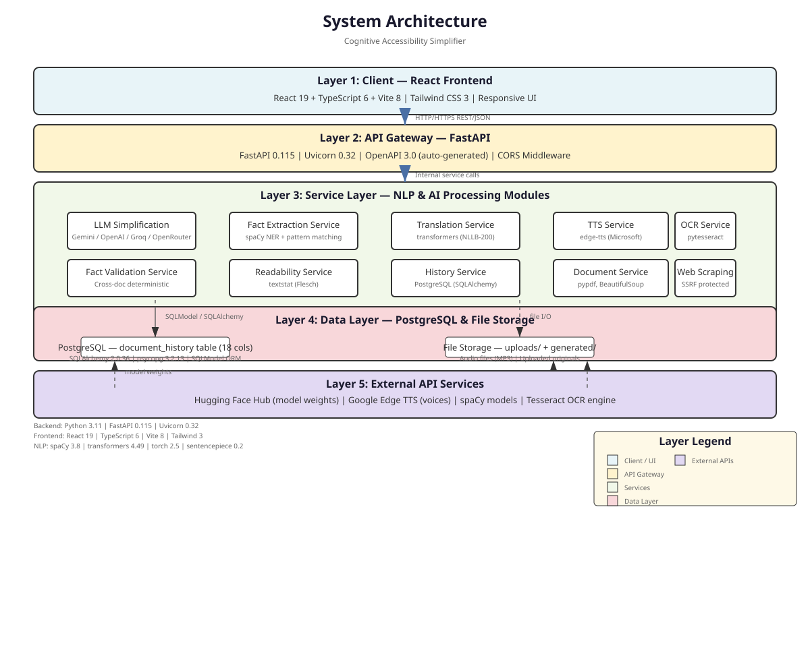

# Cognitive Accessibility Simplifier for Government Documents

## Overview
An AI-powered system designed to simplify complex government documents for citizens. The system provides a complete pipeline for document processing: text extraction from PDFs, images, and web pages, OCR for scanned documents, NLP preprocessing, LLM-based text simplification with fact preservation, structured information extraction, cross-document fact validation, readability analysis, translation to regional languages, and text-to-speech generation.

## Problem Statement
Government documents are often complex, lengthy, and difficult for citizens to understand. This creates barriers to accessing important information and services. The system aims to bridge this gap by providing automated text extraction, NLP preprocessing, LLM-based simplification, structured information extraction, fact validation, readability analysis, translation, and text-to-speech in a single pipeline.

## Proposed Solution
A modular architecture with a React frontend and FastAPI backend:

- **Frontend**: React 19 single-page application with responsive UI for document processing
- **Backend**: FastAPI backend handling document processing, NLP, LLM simplification, translation, and TTS
- **Chrome extension**: "Saral — Browser Copilot", a Manifest V3 extension that reads the current government page (or a selection), simplifies it, translates it to Kannada and plays it as audio — using the same backend
- **Document upload processing** (PDF, images, text files)
- **Webpage content extraction** from government URLs (SSRF-protected)
- **OCR for scanned documents** (Tesseract)
- **NLP preprocessing** and linguistic analysis (spaCy)
- **LLM-based text simplification** with fact preservation validation (Gemini / OpenAI / Groq / OpenRouter / Mock)
- **Rate-limit aware provider fallback**: bounded retries with exponential backoff and jitter that respect the provider's own `Retry-After` hint, so a long document survives a tokens-per-minute limit instead of failing
- **Structured information extraction** (deadlines, eligibility, amounts, etc.)
- **Fidelity validation** that checks the simplified text did not *add* anything: page markers turned into instructions, dropped qualifiers ("normally"), swapped entity types ("university" → "school") and invented numbers
- **Consistent structured extraction** that returns complete statements instead of fragments, ignores section headings and page markers, and understands Roman-numeral clauses
- **One canonical output**: the backend builds the Instant Summary and the detailed simplified text, and the website and the Chrome extension render the same result
- **Cross-document fact validation** across original, simplified, and structured text
- **Readability analysis** (Flesch Reading Ease, Flesch-Kincaid Grade Level)
- **Translation** between English and Kannada (NLLB-200 model)
- **Text-to-speech** in English and Kannada (edge-tts / Microsoft Edge TTS)
- **Document processing history tracking** (PostgreSQL)

## System Architecture



```
                        ┌─────────────────────────────────┐
                        │   React Frontend (Client)        │
                        │   React 19 | Vite | Tailwind    │
                        └──────────────┬──────────────────┘
                                       │  HTTP/HTTPS REST/JSON
                        ┌──────────────▼──────────────────┐
                        │   FastAPI API Gateway (Server)  │
                        │   FastAPI | Uvicorn | OpenAPI   │
                        └──────────────┬──────────────────┘
                                       │  Internal calls
                   ┌───────────────────┼──────────────────────────────────┐
                   │                   │                                  │
        ┌──────────▼────────┐  ┌───────▼────────┐  ┌──────────────────┐  ┌───────────────┐
        │  LLM Simplification│  │ Fact Extraction│  │ Translation        │  │ TTS Service  │
        │  Gemini/OpenAI     │  │ spaCy NER      │  │ NLLB-200           │  │ edge-tts      │
        │  Groq/OpenRouter   │  │ pattern match  │  │ transformers       │  │ Microsoft     │
        └───────────────────┘  └───────┬────────┘  └────────┬───────────┘  └───────┬──────┘
                                       │                    │                       │
                                       │          ┌─────────▼──────────┐            │
                                       │          │ Fact Validation     │            │
                                       │          │ Cross-doc deter-    │            │
                                       │          │ minimistic check     │            │
                                       │          └────────────────────┘            │
                                       │                                           │
                        ┌──────────────▼──────────────────┐     ┌────────────────▼────────┐
                        │   Document Processing Services   │     │   File Storage            │
                        │   PDF, Web, OCR, Image           │     │   uploads/ + generated/  │
                        └──────────────┬──────────────────┘     └─────────────────────────┘
                                       │
                        ┌──────────────▼──────────────────┐
                        │   PostgreSQL Database            │
                        │   document_history table (18 cols)│
                        │   SQLAlchemy 2.x | psycopg 3.x   │
                        └──────────────┬──────────────────┘
                                       │
                        ┌──────────────▼──────────────────┐
                        │   External API Services          │
                        │   Hugging Face (model weights)   │
                        │   Microsoft Edge TTS (voices)    │
                        │   Tesseract OCR engine           │
                        └──────────────────────────────────┘
```

**Pipeline flow:**
```
Input → Document Validation (file type, size, path traversal)
  ↓
Text Extraction / OCR (PDF, images, URLs)
  ↓
NLP Preprocessing (tokenization, NER, POS, key phrases)
  ↓
LLM Simplification (Gemini/OpenAI/Groq/OpenRouter/Mock)
  ↓
Structured Information Extraction (dates, money, ages, etc.)
  ↓
Fact Validation (cross-document consistency check)
  ↓
Readability Analysis (Flesch metrics comparison)
  ↓
Translation (English ↔ Kannada, NLLB model)
  ↓
Text-to-Speech (edge-tts, en-US-AriaNeural / kn-IN-GaganNeural)
  ↓
Document History Tracking (PostgreSQL)
  ↓
Output (simplified, accessible content)
```

## Milestone Status
- **M1 - Foundation**: Health endpoint, configuration, logging, security utilities
- **M2 - Document Ingestion**: PDF/text/image extraction, URL extraction with SSRF protection
- **M3 - OCR**: Tesseract OCR integration, image enhancement, EXIF rotation
- **M4 - NLP Preprocessing**: spaCy integration, NER, POS tagging, key phrase extraction
- **M5 - LLM Simplification**: Gemini/OpenAI/Groq/OpenRouter/Mock providers, fact preservation validation
- **M6 - Structured Information Extraction**: 14 categories (dates, money, ages, documents, contact, etc.)
- **M7 - Advanced Fact Validation**: Cross-document validation across 12 fact types
- **M8 - Readability Analysis**: Flesch Reading Ease, Flesch-Kincaid Grade Level
- **M9 - Translation**: NLLB-200 model, English ↔ Kannada
- **M10 - Text-to-Speech**: edge-tts (Microsoft Edge TTS), English and Kannada voices
- **M11 - Database / History**: PostgreSQL, SQLAlchemy, paginated history API
- **M12 - Final Testing, Security, Performance & Documentation**: Complete
- **M13 - Browser Copilot Extension**: Manifest V3 Chrome extension (page/selection extraction, simplification, translation, TTS, audio playback)

## Technology Stack

### Backend (Python 3.11+)
- **Framework**: FastAPI 0.115.0
- **ASGI Server**: Uvicorn 0.32.0
- **Data Validation**: Pydantic 2.9.0, pydantic-settings 2.5.0
- **Environment**: python-dotenv 1.0.0
- **HTTP Client**: HTTPX 0.27.0, Requests 2.32.3
- **File Handling**: python-multipart 0.0.6
- **PDF Processing**: PyPDF 4.0.1
- **OCR**: Pytesseract 0.3.10, Pillow 11.1.0
- **Web Scraping**: BeautifulSoup4 4.12.2
- **NLP**: spaCy 3.8.16
- **Translation**: Transformers 4.49.0, torch 2.5.0, sentencepiece 0.2.0 (NLLB-200 model)
- **TTS**: edge-tts 7.3.1
- **Database**: SQLAlchemy 2.0.36, psycopg[binary] 3.2.13 (PostgreSQL)
- **Testing**: pytest 8.3.3, pytest-asyncio 0.24.0, pytest-cov

### Frontend (React 19+)
- **Framework**: React 19.2.8 + React DOM
- **Build Tool**: Vite 8.3.0
- **Language**: TypeScript 6.0.2
- **Styling**: Tailwind CSS 3.4.19, PostCSS 8.5.28, Autoprefixer 10.6.1
- **Linting**: Oxlint 1.81.0

### Chrome Extension (Manifest V3)
- **Framework**: React 19.2.8, TypeScript 6.0.2, Vite 8.3.0, Tailwind CSS 3.4.19
- **Runtime**: Chrome 116+ (Chrome 127+ for the Alt+S shortcut)
- **No extra UI framework**: the popup reuses the same Tailwind design tokens as the website
- **Testing**: Node's built-in `node:test` runner (no extra test dependency)

## Project Structure
```
MiniProject_CSE7102/
├── backend/
│   ├── app/
│   │   ├── api/
│   │   │   └── routes/
│   │   │       ├── health.py
│   │   │       ├── documents.py
│   │   │       ├── simplification.py
│   │   │       ├── extraction.py
│   │   │       ├── validation.py
│   │   │       ├── readability.py
│   │   │       ├── translation.py
│   │   │       ├── tts.py
│   │   │       └── history.py
│   │   ├── core/
│   │   │   ├── config.py
│   │   │   ├── logging.py
│   │   │   └── security.py
│   │   ├── db/
│   │   │   ├── database.py
│   │   │   └── models.py
│   │   ├── schemas/
│   │   │   ├── document.py
│   │   │   ├── nlp.py
│   │   │   ├── simplification.py
│   │   │   ├── extraction.py
│   │   │   ├── validation.py
│   │   │   ├── readability.py
│   │   │   ├── translation.py
│   │   │   ├── tts.py
│   │   │   └── history.py
│   │   ├── services/
│   │   │   ├── document_service.py
│   │   │   ├── pdf_service.py
│   │   │   ├── webpage_service.py
│   │   │   ├── ocr_service.py
│   │   │   ├── image_service.py
│   │   │   ├── nlp_service.py
│   │   │   ├── llm_service.py
│   │   │   ├── extraction_service.py
│   │   │   ├── validation_service.py
│   │   │   ├── advanced_validation_service.py
│   │   │   ├── readability_service.py
│   │   │   ├── translation_service.py
│   │   │   ├── tts_service.py
│   │   │   └── history_service.py
│   │   └── utils/
│   │       ├── file_utils.py
│   │       ├── ocr_utils.py
│   │       └── text_utils.py
│   ├── tests/
│   │   ├── test_health.py
│   │   ├── test_documents.py
│   │   ├── test_ocr.py
│   │   ├── test_nlp.py
│   │   ├── test_simplification.py
│   │   ├── test_extraction.py
│   │   ├── test_validation.py
│   │   ├── test_readability.py
│   │   ├── test_translation.py
│   │   ├── test_tts.py
│   │   └── test_history.py
│   ├── postman/
│   │   └── Cognitive-Accessibility-Simplifier.postman_collection.json
│   ├── .env.example
│   ├── .gitignore
│   └── requirements.txt
├── extension/
│   ├── manifest.json
│   ├── popup.html
│   ├── vite.config.ts
│   ├── vite.scripts.config.ts
│   ├── public/help.html
│   ├── icons/
│   ├── scripts/
│   ├── src/
│   │   ├── background/
│   │   ├── content/
│   │   ├── popup/
│   │   ├── services/
│   │   ├── shared/
│   │   ├── styles/
│   │   ├── types/
│   │   └── __tests__/
│   └── README.md
├── shared/
│   └── saral-ui/
│       └── markdown.ts      Markdown parser shared by the website and the extension
├── docs/
│   ├── system-architecture.svg
│   └── system-architecture.png
├── frontend/
│   ├── src/
│   │   ├── components/
│   │   ├── pages/
│   │   ├── services/
│   │   ├── App.tsx
│   │   ├── main.tsx
│   │   ├── index.css
│   │   └── App.css
│   ├── public/
│   │   ├── favicon.svg
│   │   ├── hero-illustration.svg
│   │   └── icons.svg
│   ├── index.html
│   ├── package.json
│   ├── vite.config.ts
│   ├── tailwind.config.cjs
│   ├── tsconfig.json
│   └── postcss.config.cjs
├── README.md
└── PROJECT-STATUS.md
```

## Backend API

### Implemented Endpoints (16 total)

#### Health & Status
- `GET /` - Root endpoint (service info, docs links)
- `GET /api/health` - Health check service status

#### Document Ingestion (M2)
- `POST /api/documents/extract` - Extract text from uploaded PDF/image/TXT
- `POST /api/documents/url` - Extract text from government webpage URL

#### NLP Preprocessing (M4)
- `POST /api/documents/preprocess` - Linguistic analysis (sentences, entities, POS, key phrases)

#### LLM Simplification (M5)
- `POST /api/documents/simplify` - Simplify text using LLM (Gemini/OpenAI/Groq/OpenRouter/Mock)
- `POST /api/documents/simplify/validate` - Validate fact preservation

#### Structured Information Extraction (M6)
- `POST /api/documents/extract-info` - Extract structured data (14 categories)

#### Advanced Fact Validation (M7)
- `POST /api/documents/validate` - Cross-document validation (12 fact types)

#### Readability Analysis (M8)
- `POST /api/documents/readability` - Flesch Reading Ease and Grade Level comparison

#### Translation (M9)
- `POST /api/translate` - Translate text between English and Kannada
- `POST /api/translate/batch` - Batch translate multiple texts

#### Text-to-Speech (M10)
- `POST /api/tts` - Generate speech audio from text
- `GET /api/media/audio/{filename}` - Serve generated audio file

#### History (M11)
- `GET /api/history` - List document processing history (paginated)
- `GET /api/history/{document_id}` - Get history for a specific document

### Documentation
- `GET /docs` - Swagger UI
- `GET /openapi.json` - OpenAPI schema
- `GET /redoc` - ReDoc

## Frontend
The React frontend provides a responsive single-page application for interacting with the backend API.

### Frontend Features
- Document upload and text extraction interface
- Text simplification with before/after comparison
- Translation between English and Kannada
- Text-to-speech audio playback
- Responsive design with Tailwind CSS

### Frontend Setup
```bash
cd frontend
npm install
npm run dev
```

### Frontend Build
```bash
cd frontend
npm run build
```

### Frontend Linting
```bash
cd frontend
npm run lint
```

## Chrome Extension — Saral: Browser Copilot

A Manifest V3 extension that lets a citizen read a difficult government notice
without leaving the page. It contains no AI, translation, TTS or document
processing of its own: every capability comes from the same FastAPI backend
the website uses.

Full documentation: [`extension/README.md`](extension/README.md).

### Architecture
```
┌──────────────────────────────┐
│  Popup (React 19 + TS)       │  preview text, actions, result card
└──────────────┬───────────────┘
               │ chrome.runtime.sendMessage
┌──────────────▼───────────────┐
│  Background service worker   │  owns the backend URL, performs every
│  (MV3)                       │  HTTP call, injects the content script
└──────────────┬───────────────┘
               │ fetch
┌──────────────▼───────────────┐
│  FastAPI backend (existing)  │
└──────────────────────────────┘

┌──────────────────────────────┐
│  Content script (on demand)  │  extracts the main content or the user's
│  injected on "Read Active Tab"│  selection from the current page
└──────────────────────────────┘
```

### Extension Setup
```bash
cd extension
npm install
npm run build          # -> extension/dist (self-contained, loadable)
```

Load it in Chrome: `chrome://extensions` → enable **Developer mode** →
**Load unpacked** → select the `extension/dist` folder.

For UI work, `npm run dev` starts Vite with hot reload; the built output in
`dist/` is what Chrome loads.

### Extension Permissions
| Permission | Why |
| --- | --- |
| `activeTab` | Read the current page, only after the user clicks **Read Active Tab** |
| `scripting` | Inject the text extractor into that page on demand |
| `storage` | Remember the backend address and nothing else |
| `host_permissions` | `http://127.0.0.1:8000/*` and `http://localhost:8000/*` |
| `optional_host_permissions` | Requested at runtime only for a custom backend host, after Chrome's own prompt |

### Configuration
The default backend address is `http://127.0.0.1:8000`. It can be changed at
runtime from the popup (profile button → backend address) and is stored in
`chrome.storage.local`. No API key or database credential is ever sent to the
extension.

### Extension Endpoints Used
`POST /api/documents/simplify`, `POST /api/documents/extract`,
`POST /api/documents/url`, `POST /api/documents/extract-info`,
`POST /api/documents/readability`, `POST /api/translate`, `POST /api/tts` and
`GET /api/media/audio/{filename}`.

### Extension Instant Summary and Markdown
The "Instant Summary" card is built by the backend and returned in the
simplify response as `instant_summary`. The website and the extension both
render that list, so they always show the same facts with the same labels. The
labels are chosen for the document at hand - "Eligibility", "Age requirement",
"Documents needed", "Deadline", "Scholarship amount", "Conditions",
"Application process", "Selection" - and only facts the source supports are
shown.

The simplified text is parsed into a node tree by a **shared** Markdown parser
(`shared/saral-ui/markdown.ts`) and rendered as React elements, so Markdown
renders correctly and model output is never injected as HTML. The website and
the extension use the same parser, so the same text reads the same way in both.

## One Canonical Output

The backend produces one result for a given input and configuration. Neither
interface simplifies, summarises or rewrites anything on its own.

```
                       ┌──────────────────────────────┐
   website ─┐          │  POST /api/documents/simplify │
   extension ┘          │  {text, target_grade_level}   │
                       └───────────────┬──────────────┘
                                       │
                       ┌───────────────▼──────────────┐
                       │  LLM service (one prompt)      │
                       │  chunking + retry + fallback   │
                       └───────────────┬──────────────┘
                                       │
                       ┌───────────────▼──────────────┐
                       │  simplified_text               │
                       │  instant_summary               │
                       │  preserved_facts               │
                       │  validation_passed/failures    │
                       └───────────────┬──────────────┘
                          ┌────────────┴────────────┐
                          ▼                         ▼
                   website renders            extension renders
```

* The same prompt and the same service produce the text for both interfaces.
* The Instant Summary is derived from the structured extraction of the
  **source** document, never from the model output.
* Translation, audio and copy all use the same validated `simplified_text`.
* The Markdown parser is shared (`shared/saral-ui/markdown.ts`), so the two
  interfaces cannot read the same text differently.

### Extension Known Limitations
- **Hindi is not available**: the backend translation model validates the
  language code against `['en', 'kn']`, so the Hindi option is shown disabled
  and marked *Unavailable* rather than silently returning English.
- Chrome settings, the Chrome Web Store, the built-in PDF viewer and other
  `chrome://` pages block extensions; the popup explains this instead of
  failing silently.
- The reading-grade badge only appears when the backend actually measured the
  text; otherwise the card says "Grade not measured".
- The `Alt+S` shortcut uses `chrome.action.openPopup()` and needs Chrome 127+.

## Fidelity Validation (no invented facts)

A simplification that reads well can still be wrong. Saral checks the simplified
text against the source in both directions:

* **Fact preservation** (existing): dates, amounts, percentages, ages and
  quantities from the source must still be present.
* **Fidelity checks** (new, `backend/app/services/text_fidelity.py`): the
  simplified text must not *add* anything the source does not state.

| Problem | Example | How it is caught |
| --- | --- | --- |
| A page marker becomes an instruction | "You must declare on Page 4 of 7 of your application" | Page references that only exist as pagination artifacts are reported, and any page reference that turned into an instruction is reported |
| Certainty is upgraded | "normally announced" → "will be announced" | A hedge from the source that is missing from the output is reported, along with the definiteness marker that replaced it |
| A condition is dropped | "subject to the condition that ..." removed entirely | Reported when the output contains no conditional construction at all |
| An entity is swapped | "university/college/institute" → "school" | Reported when one member of an organisation family replaces another |
| An obligation invents a number | "You must pay Rs. 500 by 30 June" | Reported when a number in an obligation does not occur in the source |

Two preventive steps back this up:

1. **Artifacts are removed before the model sees the text.** Standalone
   pagination lines ("Page 4 of 7", "--- Page 3 (text) ---") are stripped, so
   the model can never turn them into content.
2. **The prompt states the rules** - ignore artifacts, keep qualifiers, keep
   the exact kind of organisation, and never add a step the source does not
   state.

Any issue found is returned in `validation_failures` and flips
`validation_passed` to `false`. Both the website and the extension show the
specific reasons, so a simplified document is never presented as fully
validated just because it is readable.

**This is a safety net, not a guarantee.** The checks look for specific,
recognisable failure patterns; they cannot prove that a reworded sentence
means exactly what the original meant. The original document always remains
the authority.

## Rate-Limit Handling (long documents)
A long government notice is split into chunks and each chunk is sent to the LLM
provider separately. Providers meter this against a per-minute token budget
(Groq allows 8,000 tokens per minute on the free tier), so a long notice can
exceed the budget part way through and the provider answers **HTTP 429**.

Saral handles this in `backend/app/services/llm_retry.py` and
`backend/app/services/llm_service.py`:

| Situation | Behaviour |
| --- | --- |
| Provider answers 429 | The delay the provider asked for is read from `Retry-After`, `x-ratelimit-reset-tokens`, or the `"try again in 22.2s"` message, and the chunk is retried after that delay. |
| Provider answers 5xx / `503 UNAVAILABLE` | Classified as transient and retried with exponential backoff and jitter. |
| No provider hint | Exponential backoff (`base_delay * 2^(attempt-1)`) plus +/- 25 % jitter, capped at `LLM_RETRY_MAX_DELAY`. |
| One provider is rate limited | The next configured provider is tried in the same round, so a healthy fallback finishes the chunk immediately. |
| Every provider fails | The round is repeated after the backoff, up to `LLM_MAX_RETRIES` rounds. |
| Authentication error | Never retried. |
| All attempts exhausted | The request fails with a clear, actionable error. A failed chunk is **never** reported as a successful simplification. |

The retry waits use `asyncio.sleep` and the provider calls run in a worker
thread, so the FastAPI event loop is never blocked while the backend waits for
a quota window to reset. `LLM_SIMPLIFICATION_TIMEOUT` (default 240 s) bounds
the total time one request may spend waiting.

Fact validation, readability analysis, history recording and the response
contract are unchanged: a document that needed a fallback provider is still
validated, and the response reports `validation_passed` and
`validation_failures` exactly as before.

## Supported Input Formats
- **Documents**: PDF (.pdf), Text (.txt), Word (.docx, .doc)
- **Images**: JPEG (.jpg, .jpeg), PNG (.png)
- **Websites**: HTTP/HTTPS URLs

## Supported Languages
- **English** (`en`): Full support for all features
- **Kannada** (`kn`): Full support for translation and TTS

## Security Features
- **File Upload Validation**: Extension whitelist (pdf, txt, docx, doc, jpg, jpeg, png), size limit (default 10MB), empty file detection, filename sanitization
- **SSRF Protection**: URL validation blocks `file://` scheme, non-HTTP schemes, localhost, loopback, RFC 1918 private IP ranges (10.x, 172.16-31.x, 192.168.x), and link-local addresses (including AWS metadata 169.254.169.254)
- **Path Traversal Prevention**: Filename sanitization strips `../`, `..\\`, and dangerous characters
- **Error Response Masking**: Database credentials and internal connection strings are never exposed in error responses
- **Secrets Management**: API keys loaded from `.env` file (gitignored); never hardcoded in source
- **Extension CORS**: web origins still have to be listed in `CORS_ORIGINS`. Chrome extension origins (`chrome-extension://<id>`) are matched by `CORS_ORIGIN_REGEX`, because a web page can never send that origin — no additional web origin is exposed

## Testing
```bash
cd backend
python -m pytest tests/ -v
```
- **Total Tests**: 457 (+1 skipped when a local origin is not on the configured allow-list)
- **Passing**: 457
- **Failing**: 0
- **Test Coverage**: ~70% across all modules

**Extension Tests:**
```bash
cd extension
npm test                # 104 unit tests (node:test)
npm run verify:backend  # 31 live checks against a running backend
npm run verify:scholarship # live Instant Summary check against a running backend
```
- `src/__tests__/config.test.ts` — backend URL validation, limits, language support (13)
- `src/__tests__/extractor.test.ts` — text cleaning, truncation, selection priority (11)
- `src/__tests__/facts.test.ts` — important-fact derivation from backend responses (10)
- `src/__tests__/errors.test.ts` — HTTP status to user-message mapping (10)
- `src/__tests__/api.test.ts` — request building and error handling against a stubbed `fetch` (8)
- `src/__tests__/guards.test.ts` — duplicate-submission guard (4)
- `src/__tests__/markdown.test.ts` — Markdown parsing, escape artefacts, HTML safety (23)
- `src/__tests__/factsSummary.test.ts` — Instant Summary quality, duplicated labels, headings, page markers (15)
- `src/__tests__/canonicalOutput.test.ts` — the canonical summary is shared with the website (10)

**Backend rate-limit tests** (`backend/tests/test_llm_retry.py`, 37 tests):- Groq 429 followed by a successful retry, honouring the provider's retry delay
- Groq 429 followed by a successful fallback provider
- Gemini 503 `UNAVAILABLE` followed by recovery
- All providers unavailable after the retry budget is exhausted
- A failed chunk is never reported as a successful simplification
- Fact validation still runs on the combined chunked output
- One user action runs the pipeline exactly once (no duplicate processing)

**Backend fidelity tests** (`backend/tests/test_text_fidelity.py`, 31 tests):
- A page marker ("Page 4 of 7") is stripped before the model sees the text
- A page marker turned into an instruction is detected and reported
- "normally" being dropped and replaced by "will" is detected
- "university/college/institute" being replaced by "school" is detected
- A faithful simplification raises no issue
- The endpoint reports `validation_passed: false` with the specific reasons

**Backend extraction quality tests** (`backend/tests/test_extraction_quality.py`, 14 tests):
- A section heading is never returned as a procedure step
- A page marker is never returned as a fact, while dates, amounts, percentages
  and age limits are still extracted
- Eligibility requirements and conditions are complete statements
- The nine Roman-numeral clauses of a scholarship notice are captured as steps
- Document names are short noun phrases, not sentence fragments

**Backend canonical output tests** (`backend/tests/test_canonical_output.py`, 24 tests):
- The endpoint returns the same Instant Summary for the same input
- The summary is built from the source document, never from the model output
- Labels are never duplicated, page markers and headings are never facts
- The age rule keeps its direction ("under 30 years" is never "30+ years")
- Long documents are chunked and combined in order, without cutting a clause
- Broken model output is reported instead of being presented as a good result
- Markdown, including escaped characters and HTML, is passed through unchanged

**Live API Testing (M12 Verification):**
8 of 16 endpoints verified with live HTTP requests:
- `GET /api/health` ✓
- `POST /api/translate` (en→kn) ✓
- `POST /api/tts` (English) ✓
- `GET /api/history` ✓
- `POST /api/documents/simplify` ✓ (returns 429 - quota exhausted, error handling works)
- `POST /api/documents/extract-info` ✓
- `POST /api/documents/validate` ✓
- `POST /api/documents/readability` ✓

Remaining 8 endpoints implemented but not live-tested in M12:
- `GET /` (root), `POST /api/documents/extract`, `POST /api/documents/preprocess`, `POST /api/documents/simplify/validate`, `POST /api/documents/url`, `GET /api/history/{document_id}`, `GET /api/media/audio/{filename}`, `POST /api/translate/batch`

Run with coverage:
```bash
python -m pytest tests/ --cov=app --cov-report=term-missing
```

## Installation

### Backend
1. Clone the repository
2. Navigate to the backend directory: `cd backend`
3. Install dependencies: `pip install -r requirements.txt`
4. Download spaCy English model: `python -m spacy download en_core_web_sm`
5. Configure environment variables: copy `.env.example` to `.env` and fill in values
6. Ensure Tesseract OCR is installed on your system (for M3 OCR features)
7. Ensure PostgreSQL is running (for M11 history tracking; app starts without it)

### Frontend
1. Navigate to the frontend directory: `cd frontend`
2. Install dependencies: `npm install`
3. Configure API URL if needed (edit `src/services/api.ts`)

### Chrome Extension
1. Navigate to the extension directory: `cd extension`
2. Install dependencies: `npm install`
3. Build: `npm run build`
4. Load `extension/dist` through `chrome://extensions` → Developer mode → Load unpacked
5. Make sure the backend is running on `http://127.0.0.1:8000` (or set a different address from the popup's settings)

## Environment Configuration
Key environment variables (set in `.env`):
- `APP_NAME`: Application name
- `VERSION`: API version
- `ENVIRONMENT`: Deployment environment (development/production)
- `DEBUG`: Enable debug mode (boolean)
- `HOST` / `PORT`: Server host and port
- `MAX_FILE_SIZE_MB`: Maximum upload file size (default: 10)
- `CORS_ORIGINS`: Allowed CORS origins (JSON list)
- `CORS_ORIGIN_REGEX`: Pattern for extra allowed origins (default: Chrome extension origins)
- `LLM_MAX_RETRIES`: Attempts per provider for one chunk (default: 3)
- `LLM_RETRY_BASE_DELAY`: First backoff step in seconds (default: 2.0)
- `LLM_RETRY_MAX_DELAY`: Upper bound for a single wait in seconds (default: 60.0)
- `LLM_RETRY_JITTER`: Jitter applied to the backoff, 0-1 (default: 0.25)
- `LLM_SIMPLIFICATION_TIMEOUT`: Overall budget for one simplification request in seconds (default: 240)
- `LLM_REASONING_EFFORT`: Reasoning effort for reasoning models such as gpt-oss (default: low). These models spend part of `LLM_MAX_TOKENS` on internal reasoning, which can leave the answer truncated. Set to an empty string to use the provider default.
- `LLM_PROVIDER`: Provider for simplification (gemini, openai, groq, openrouter, mock, auto)
- `LLM_API_KEY`: API key for the chosen LLM provider (backward compatibility)
- `LLM_MODEL`: Default LLM model (default: gpt-3.5-turbo)
- `GEMINI_API_KEY`: Google Gemini API key
- `GEMINI_MODEL`: Gemini model name (default: gemini-pro)
- `GROQ_API_KEY`: Groq API key
- `GROQ_MODEL`: Groq model name
- `OPENROUTER_API_KEY`: OpenRouter API key
- `OPENROUTER_MODEL`: OpenRouter model name
- `DATABASE_URL`: PostgreSQL connection string
- `USE_DATABASE`: Enable/disable database history tracking (default: true)
- `TRANSLATION_PROVIDER`: Translation model provider (nllb)
- `TRANSLATION_API_KEY`: Translation service API key (if required)
- `TTS_PROVIDER`: TTS provider (google)
- `TTS_API_KEY`: TTS service API key (if required)
- `LOG_LEVEL`: Logging level (default: INFO)

## Running the Application

### Backend
```bash
cd backend
python -m uvicorn app.main:app --reload --host 127.0.0.1 --port 8000
```
Or for production:
```bash
cd backend
python -m uvicorn app.main:app --host 0.0.0.0 --port 8000
```

### Frontend
```bash
cd frontend
npm run dev
```

### Frontend Build for Production
```bash
cd frontend
npm run build
```

## API Documentation
- Swagger UI: http://localhost:8000/docs
- ReDoc: http://localhost:8000/redoc
- OpenAPI Schema: http://localhost:8000/openapi.json
- Postman Collection: `backend/postman/Cognitive-Accessibility-Simplifier.postman_collection.json`
